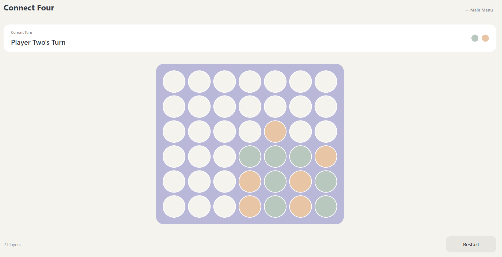

# FOUR. — Connect Four

## Screenshot

## Requirements
- Windows 10/11
- Visual Studio 2022 with **.NET desktop development** workload and .NET 8 SDK

## Run
1. Extract the ZIP.
2. Open `ConnectFour.csproj` in Visual Studio.
3. Build and press **F5**.

## Features
- 6 × 7 board with gravity-based moves
- Horizontal, vertical, and diagonal win detection
- Draw detection, restart, main menu, and result screen
- MVVM navigation via `ContentControl` and typed `DataTemplate`
- Centralized colors and button styles

## Structure
- `Models/`: pure game rules
- `ViewModels/`: UI state, commands, navigation
- `Views/`: WPF user controls
- `Styles/`: shared theme
- `Converters/`: cell state presentation

## Notes
This version is local two-player only; no computer opponent is included. Build has not been verified in this environment (Windows WPF toolchain unavailable).
